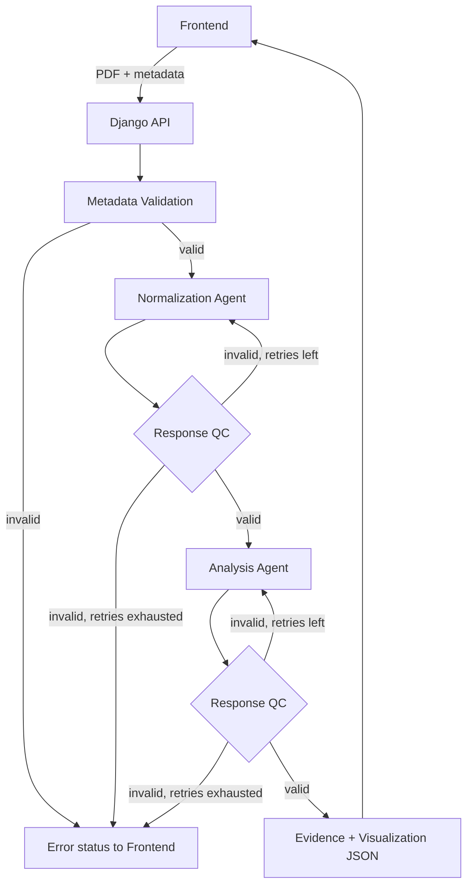

# SatuSurvey — Concept Brief

**Document type:** Product and technical concept brief
**Status:** Working draft, revision 2 (simplified MVP flow)
**Scope:** Product concept, MVP processing workflow, and system architecture
**Out of scope:** Detailed database schema, deployment topology, implementation-level API contracts

---

## 1. Executive Summary

SatuSurvey turns information in report PDFs into structured, traceable evidence and presents it as ready-to-render visualizations.

The first revision of this brief described a fully modular pipeline with hard-coded processing stages, OCR, a job queue, Python workers, source verification, and human review. For an MVP this is too heavy. This revision replaces it with a **short, synchronous, agent-based pipeline**:

```
PDF Report
  -> Metadata Validation (hard-coded)
  -> Normalization Agent (AI: extract + normalize evidence to JSON)
  -> Response QC
  -> Analysis Agent (AI: analyze evidence + generate visualization JSON)
  -> Response QC
  -> Visualization in Frontend
```

The backend is a single **Django** application (modular monolith). There is no separate worker, queue, or OCR component in the MVP. All steps run synchronously within the request, and the frontend receives either a final result or an explicit error status.

What stays from the original concept: provenance is a first-class requirement, AI output is never treated as automatically correct, and failures must be visible and explainable.

## 2. Product Concept

### 2.1 Problem and opportunity

Reports contain useful metrics, tables, and claims, but they are hard to compare or analyze while locked in PDFs. Common issues include missing context (period, geography, unit, definition), inconsistent metric labels, and difficulty tracing a displayed number back to where it came from.

### 2.2 MVP objective

Given a report PDF with complete metadata, produce:

1. **Structured evidence:** each fact or metric as a JSON record in a consistent format.
2. **Traceable evidence:** each record keeps the original wording and a source location (e.g., page, table, or excerpt) wherever the model can identify it.
3. **Analysis and visualization:** a JSON description of charts/summaries that the frontend can render directly.
4. **Transparent failure:** if the pipeline cannot produce valid output, the user sees which stage failed and why.

### 2.3 Core design principles

- **Preserve provenance.** Do not keep only the extracted value; keep the original text and where it came from.
- **Do not guess silently.** If context such as period, unit, or geography is absent, the field is marked unknown rather than invented.
- **Validate structure deterministically.** The Response QC module checks format and schema in code. It does not rely on an LLM to judge its own output.
- **AI output is a proposal, not a fact.** Agents return structured JSON; the QC module enforces the contract, and the UI shows the evidence alongside conclusions.
- **Keep it simple.** One Django application, synchronous flow, bounded retries.
- **Make failures visible.** Failures end in an explicit error status with stage and reason, never a hung request.

## 3. Core Concepts and Terminology

### 3.1 Source report

The uploaded PDF and its metadata (e.g., title, publisher, publication date, reporting period). The original file is retained separately from the extracted evidence.

### 3.2 Metadata validation

A simple hard-coded check that the required metadata is present and well-formed before any AI is invoked. It does not verify that the metadata is *true*, only that it is complete. This prevents spending AI calls on incomplete submissions.

### 3.3 Normalized evidence record

A standardized JSON representation of a fact or metric extracted from the report. It may contain:

- Metric or claim name (normalized label) and the original label.
- Value and unit.
- Reporting period.
- Geography or population.
- Definition or measurement basis, if stated.
- Source location (page, table, excerpt) and original wording.
- Fields explicitly marked as unknown or ambiguous.

Normalization maps extracted content to a consistent shape. It does not establish that the content is true.

### 3.4 Normalization Agent

An AI agent that reads the PDF, extracts relevant evidence, and normalizes each item into the agreed JSON evidence format. It combines what the original design split into extraction, candidate identification, and normalization. It must not fill in missing facts; unknowns stay marked as unknown.

### 3.5 Analysis Agent

An AI agent that receives the normalized evidence and produces:

- An analysis of the evidence (key findings, comparisons, trends, caveats such as missing context).
- Visualization specifications in JSON, restricted to a small set of chart/summary types that the frontend supports.

Analysis must reference the evidence records it is based on, so the frontend can link a conclusion back to its sources.

### 3.6 Response QC

A single deterministic module shared by both agents. It validates an agent's response against the expected contract for that stage and, if the response is invalid, sends the error back to the agent for a retry. See Section 4.4.

## 4. MVP Workflow

All stages run synchronously. The frontend sends the request and waits for the final result or error.

### 4.1 Stage 1 — Input PDF and metadata validation

1. The user uploads the PDF together with its metadata.
2. Django checks permissions and basic file constraints (file type, size, page limit).
3. Hard-coded validation checks that all required metadata fields are present and well-formed.
4. If validation fails, the request is rejected immediately with a clear list of missing or invalid fields. No AI is called.
5. If validation passes, the original file is stored and the pipeline continues.

### 4.2 Stage 2 — Normalization Agent

1. The agent receives the PDF (or its content) and the validated metadata.
2. It extracts evidence and normalizes each item into the evidence JSON format, including source location and original wording.
3. Its raw response goes to Response QC.

### 4.3 Stage 3 — Analysis Agent

1. The agent receives the QC-approved normalized evidence and the report metadata.
2. It produces the analysis and the visualization JSON.
3. Its raw response goes to Response QC.

### 4.4 Response QC (shared module)

One module serves both agents. It is told which stage it is checking and applies that stage's contract.

**What it checks (deterministic):**

- Response is parseable JSON.
- Response conforms to the stage's schema (required fields, data types, allowed values).
- For normalization: each evidence record has the required fields and a source reference; unknowns are marked explicitly rather than omitted.
- For analysis: visualization specs use only supported chart types and reference existing evidence records.

**What it does not check:** whether a value is actually correct or true. QC validates the *format* and *contract*, not the truth of the content.

**Retry behavior:**

1. If the response is valid, it is passed to the next stage.
2. If invalid, QC returns the error details and the original task to the same agent that produced the response.
3. The agent may be retried a maximum of **2 times** (up to 3 attempts in total per stage).
4. If the response is still invalid after the second retry, QC stops the pipeline and returns an error status to the frontend, including the failed stage and the reason.



### 4.5 Stage 4 — Visualization in the frontend

The frontend renders:

- The visualization JSON (charts and summaries).
- The normalized evidence behind each visualization.
- Source locations and original wording, so users can check a result against the report.
- Caveats from the analysis, including fields marked unknown.
- An error state when the pipeline fails: which stage failed and the reason.

## 5. Result and Status Model

The MVP keeps the principle that a single `is_valid` flag is not enough, but with fewer states.

**Request outcome:**

- `completed`: both agents passed QC; evidence and visualization are returned.
- `rejected_metadata`: required metadata missing or invalid.
- `failed_normalization`: Normalization Agent did not produce a valid response within the retry limit.
- `failed_analysis`: Analysis Agent did not produce a valid response within the retry limit.
- `failed_system`: unexpected error or timeout (e.g., AI provider unavailable).

Names are illustrative.

**Per-record fields:** each evidence record carries explicit unknown/ambiguous markers and its source location, so uncertainty stays visible even for a `completed` request.

**Error responses** include the failed stage, a reason, and the number of attempts made.

## 6. System Architecture

### 6.1 Architectural direction

A single **Django** application as a modular monolith. Python is used throughout; there is no separate worker or queue in the MVP.

### 6.2 Logical modules

- **Auth and Access:** authentication and authorization.
- **Reports:** PDF upload, file constraints, and metadata.
- **Metadata Validation:** hard-coded completeness checks.
- **Agents:** a Normalization Agent and an Analysis Agent behind an explicit provider-agnostic interface, including prompts and output contracts.
- **Response QC:** the shared validation and retry-orchestration module.
- **Pipeline:** orchestrates the synchronous flow and maps outcomes to result/error statuses.
- **Results:** stores and serves evidence and visualization JSON.

These are internal modules, not separate deployable services.

### 6.3 Data and storage

- **PostgreSQL:** reports, metadata, evidence records, analysis results, and pipeline outcomes (including attempts and errors). The detailed schema is deferred.
- **File storage:** the original PDFs, stored separately from relational records (local or S3-compatible storage; to be decided).

### 6.4 Synchronous operation

The whole pipeline runs within the request/response cycle, as agreed. This has consequences the implementation must handle:

- **Request duration.** Two AI calls plus up to four retries can take a long time. Set explicit timeouts per agent call and an overall limit, and align the web server and proxy timeouts accordingly.
- **Input limits.** Enforce maximum file size and page count so requests stay within reasonable processing time.
- **Frontend feedback.** Show a clear loading state, and handle timeouts as `failed_system`.
- **Provider failures.** AI provider errors count as system failures and should be reported, not retried indefinitely.

If real usage shows that requests are regularly too slow, moving the pipeline to a background task is the natural next step (see Section 8).

### 6.4.1 Reliability notes

- **Bounded retries:** the 2-retry limit applies per agent stage.
- **Idempotency:** a repeated submission should not create duplicate evidence records for the same report.
- **Logging:** log report identifier, stage, attempt number, and QC error without exposing unnecessary document content.
- **Versioning:** record which prompt version, model, and schema version produced a result.
- **Access control:** documents and results must respect user permissions.
- **Safe file handling:** validate file type and size, and treat uploaded content as untrusted input (including as potential prompt-injection content for the agents).

## 7. Technology Summary

| Concern | MVP choice | Notes |
|---|---|---|
| Backend | Django | Single modular monolith |
| Database | PostgreSQL | Structured records and outcomes |
| File storage | To be decided | Keep PDFs outside relational rows |
| AI agents | Provider-agnostic adapter | Store model and prompt version |
| Output validation | Schema validation in code | e.g., Pydantic or JSON Schema |
| Queue / workers | None in MVP | Reconsider if synchronous latency is a problem |
| OCR | None in MVP | See open questions on scanned PDFs |

## 8. Deferred / Post-MVP

The following items from the previous revision are intentionally postponed:

- Dedicated OCR and a deterministic extraction pipeline.
- Background job queue and Python workers (asynchronous processing).
- Source registry and source verification/resolution.
- Rule Engine with a full set of validation rules and reason codes.
- Cross-report conflict detection and resolution.
- Human review queue and reviewer feedback.
- Separate NestJS backend, BullMQ/Redis, and FastAPI services.

These can be reintroduced when there is concrete evidence that the MVP's accuracy, latency, or review needs justify them.

## 9. Suggested Implementation Phases

### Phase 1 — MVP pipeline
- Django project and module structure.
- PDF upload, file constraints, metadata model, and hard-coded metadata validation.
- Evidence and visualization JSON contracts (schemas).
- Normalization Agent and Analysis Agent behind a provider interface.
- Response QC with the 2-retry loop and error statuses.
- Frontend: upload, loading/error states, visualization and evidence display with source locations.

### Phase 2 — Evaluation and hardening
- Build a small labeled set of reports and expected evidence.
- Measure extraction accuracy, QC failure/retry rates, latency, and cost per report.
- Improve prompts and schemas based on observed failure patterns.

### Phase 3 — Based on evidence from Phase 2
- Introduce asynchronous processing if latency is a problem.
- Add OCR or a deterministic extraction path if scanned PDFs or accuracy demand it.
- Add rule-based validation, source verification, or review flows where error patterns justify them.

## 10. Evaluation and Quality Metrics

Measure reliability rather than trusting an agent's self-reported confidence.

- Evidence extraction accuracy (values, units, periods, source locations).
- Percentage of records with complete provenance.
- QC first-pass success rate, retry rate, and final failure rate per agent.
- End-to-end latency and timeout rate.
- Cost per report.
- Accuracy of the analysis relative to manually reviewed examples.

Note that Response QC only guarantees format. Content accuracy has to be measured separately against manually reviewed examples.

## 11. Decisions and Open Questions

### Current working decisions
- SatuSurvey is a report-to-evidence-and-visualization system.
- Flow: PDF -> Metadata Validation -> Normalization Agent -> QC -> Analysis Agent -> QC -> Frontend.
- Metadata validation is hard-coded and checks completeness only.
- Both agents output JSON; the Analysis Agent's visualization JSON is directly consumable by the frontend.
- One shared Response QC module; max 2 retries per stage; error status to frontend afterward.
- All processing is synchronous.
- Django is the single backend (modular monolith).
- Provenance (source location and original wording) is retained in evidence records.
- Detailed database schema is deferred.

### To decide
- Required metadata fields and their formats.
- Evidence JSON schema and the visualization JSON schema (supported chart types).
- How PDFs are given to the Normalization Agent (native PDF input vs. text extracted beforehand) and how scanned PDFs are handled without OCR (reject or accept with lower quality).
- Maximum file size, page count, and overall request timeout.
- Which AI provider and models to use per agent.
- Whether the QC retry message includes the full previous output or only the error details.
- Whether very large reports need chunking before normalization.
- File storage choice.
- Frontend charting library and how it maps to the visualization JSON.

## 12. Summary

SatuSurvey's MVP is a short, synchronous pipeline: validate metadata, let an AI agent normalize the report into JSON evidence, let a second agent analyze it and produce visualization JSON, and check each agent's output with one shared QC module that allows two retries before reporting an error. A single Django backend hosts everything. The principles of traceability and visible uncertainty remain, while OCR, queues, workers, source verification, and human review are deferred until the MVP shows they are needed.

**Database schema is intentionally not specified in this brief** and should be designed separately once the evidence model and product requirements are agreed upon.
